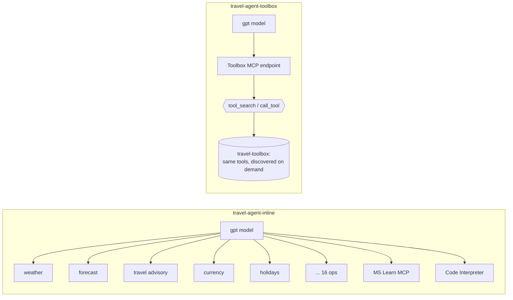

# Microsoft Foundry Toolbox demo: inline tools vs. Toolbox with tool search

This repo builds two **prompt agents** in Microsoft Foundry. They use the same model, the same instructions and the same tools. The only difference is how each agent gets its tools:

| Agent | How it gets tools | What the model sees on each turn |
|---|---|---|
| `travel-agent-inline` | Every tool is attached directly to the agent | All tool definitions (16 OpenAPI operations, MCP tools, Code Interpreter) |
| `travel-agent-toolbox` | One MCP connection to a **Foundry Toolbox** with **tool search** turned on | Only `tool_search` and `call_tool`. It searches for the tools it needs. |

Open both agents in the Foundry portal playground and run the same prompt in each. You can compare tool calls, token usage and latency side by side. You can also run `compare.py` to print the same comparison as a table.



## Concepts

### What is a Foundry Toolbox?

A **toolbox** is a managed resource in a Microsoft Foundry project. You choose a set of tools once and publish them behind **one MCP-compatible endpoint**. You don't wire each tool, credential and policy into every agent separately. Agents connect to the toolbox endpoint and find the tools at runtime.

**The problem it solves.** Without a toolbox, every agent sets up its own tools. That leads to:
- duplicated work across teams
- credentials copied into many places
- inconsistent governance
- every tool change requiring an agent change and a redeploy

As the number of agents grows, this becomes expensive to run and hard to secure.

**What a toolbox gives you:**

| Capability | What it means |
|---|---|
| **Single endpoint** | An agent connects to one MCP endpoint and gets every tool behind it. You can add, remove or reconfigure tools without changing agent code. |
| **Centralized authentication** | The toolbox injects credentials, refreshes tokens and enforces policy at runtime, using project connections, Microsoft Entra ID, managed identity or OAuth identity passthrough. Agents never hold tool credentials. |
| **Governance** | You can apply guardrails (Responsible AI policies) to tool inputs and outputs at the toolbox level. |
| **Versioning** | Each change creates an immutable version. You test a version on its own endpoint and then **promote** it to default. Every agent on the consumer endpoint picks it up without being redeployed. |
| **Reuse across runtimes** | Toolboxes live in Foundry but aren't tied to it. Foundry prompt agents, hosted agents, Microsoft Agent Framework, LangGraph, GitHub Copilot and any MCP client can use the same toolbox. |
| **Tool search and skills** | Find tools on demand, and attach reusable [skills](https://learn.microsoft.com/azure/foundry/agents/how-to/tools/skills). |

**What can go in a toolbox:** MCP servers, OpenAPI tools, Web Search, Azure AI Search, File Search, Code Interpreter, Agent-to-Agent (A2A), browser automation, Fabric IQ, Work IQ, skills and tool search.

Function calling can't go in a toolbox, because your own code runs it client-side. Attach function tools directly to the agent instead.

**Two endpoints:**

| Endpoint | URL | Use it for |
|---|---|---|
| Consumer | `{project_endpoint}/toolboxes/{name}/mcp?api-version=v1` | Agents in production. It always serves the **default version**. |
| Version-specific | `{project_endpoint}/toolboxes/{name}/versions/{version}/mcp?api-version=v1` | Testing a new version before you promote it |

Tool names inside a toolbox are namespaced by source, for example `weather___GetCurrentWeather` for an OpenAPI operation or `microsoft_learn___microsoft_docs_fetch` for an MCP tool.

### What is tool search?

As a toolbox grows to dozens or hundreds of tools, sending every tool definition to the model on every turn causes three problems:

1. **Cost.** Every tool definition adds input tokens, whether or not the model uses that tool.
2. **Context.** Tool schemas take up space that conversation history and grounding data need.
3. **Accuracy.** With a long list to choose from, the model is more likely to pick a similar but wrong tool.

**Tool search** solves this. When you add `{"type": "toolbox_search"}` to a toolbox, `tools/list` hides every tool and returns only two meta-tools:

- **`tool_search`**: the model describes what it needs, for example `"currency exchange"`, and gets back the best-matching tool definitions. It takes a `query` and an optional `limit` (default 5, max 10).
- **`call_tool`**: the model calls any tool it found, by name.

The model can call `tool_search` several times in one turn, and tools it finds stay callable for the rest of that turn. Foundry ranks matches with **BM25** over each tool's name, description and parameters. That's why good tool descriptions matter so much.

**Tuning discovery:**

| Option | Effect |
|---|---|
| **Pin** (`tool_configs: {"<tool>": {"pin": true}}`, or `"*"` for all) | The tool always appears in `tools/list` next to the meta-tools, so no search round-trip is needed. |
| **`additional_search_text`** | Adds your organisation's vocabulary to a tool's search index. It's used only for ranking and is never shown to the model. |
| **Auto-pinning** | Foundry tracks which tools each user calls most and shows them directly after a short warm-up. No setup needed. |

**When to use it:** for toolboxes with roughly **10–15+ tools**, or when different tasks need different subsets of tools.

**Best practices:**
- Give every tool a clear description.
- Tell the model in its instructions to call `tool_search` before saying it can't do something.
- Pin tools that are needed on almost every turn.

### Inline tools vs. toolbox with tool search

| | Inline tools | Toolbox + tool search |
|---|---|---|
| Where tools are defined | On each agent | Once, in the toolbox |
| Credentials | Set up per agent | Managed centrally by the toolbox |
| Changing a tool | Update and redeploy every agent | Publish a new toolbox version and promote it |
| What the model sees each turn | Every tool definition | `tool_search` + `call_tool` (+ pinned tools) |
| Token cost as tools grow | Grows with every tool added | Stays roughly flat |
| Extra model turns | None | One `tool_search` round-trip per capability (unless pinned) |
| Best for | A small, fixed set of tools | Large or shared tool catalogs, many agents, governed environments |

## Tools used

Every tool calls a free public API. None of them needs an API key.

| Type | Name | Backing API | Operations |
|---|---|---|---|
| OpenAPI | `weather` | wttr.in | current weather |
| OpenAPI | `geocoding` | Open-Meteo geocoding | city → lat/long, country, timezone |
| OpenAPI | `forecast` | Open-Meteo forecast | daily forecast |
| OpenAPI | `air_quality` | Open-Meteo air quality | current AQI, PM2.5, PM10, ozone |
| OpenAPI | `travel_advisory` | U.S. Department of State | advisory level (1–4) + summary |
| OpenAPI | `country_info` | World Bank | country profile, indicators (population, GDP) |
| OpenAPI | `currency` | Frankfurter (ECB) | latest rates, historical rates, currency list |
| OpenAPI | `holidays` | Nager.Date | public holidays, next holidays, long weekends, countries |
| OpenAPI | `world_time` | timeapi.io | current local time |
| MCP | `microsoft_learn` | Microsoft Learn MCP server | docs search / fetch / code samples |
| Built-in | `code_interpreter` | Foundry | run Python (calculations, charts) |
| Toolbox only | `toolbox_search` | Foundry | turns on tool search |

The OpenAPI specs live in [tools/openapi](tools/openapi). [catalog.py](catalog.py) is the single source of truth: it builds both the inline tool list and the toolbox tool list from those specs.

## Prerequisites

- An Azure subscription with a **Microsoft Foundry project** in a [region that supports toolboxes](https://learn.microsoft.com/azure/foundry/agents/concepts/limits-quotas-regions#tool-support-by-region-and-model).
- A chat model deployment in that project (tested with `gpt-5.4`).
- The **Foundry User** role on the project for the identity that runs the scripts.
- Python 3.10+ and the [Azure CLI](https://learn.microsoft.com/cli/azure/install-azure-cli). Sign in with `az login`.

## Setup

```powershell
git clone https://github.com/sriaishwarya1709/foundry-toolbox-demo.git
cd foundry-toolbox-demo

python -m venv .venv
.\.venv\Scripts\Activate.ps1        # macOS/Linux: source .venv/bin/activate
pip install -r requirements.txt

copy .env.example .env              # macOS/Linux: cp .env.example .env
# edit .env -> PROJECT_ENDPOINT and MODEL_DEPLOYMENT_NAME
```

You can find `PROJECT_ENDPOINT` on your project's **Overview** page in the [Foundry portal](https://ai.azure.com). It looks like `https://<account>.services.ai.azure.com/api/projects/<project>`.

## Run the demo

```powershell
python setup_demo.py      # creates the toolbox + both agents
python verify_toolbox.py  # lists toolbox tools and tests tool_search
python compare.py         # runs the same prompts against both agents
```

> [!NOTE]
> Tool search indexes a new toolbox version in the background. Wait a few minutes after you run `setup_demo.py` before you test the toolbox agent.

You can pass your own prompts to `compare.py`:

```powershell
python compare.py "What's the weather and air quality in Delhi right now?"
```

### In the Foundry portal

1. Open your project at [ai.azure.com](https://ai.azure.com). Use the new Foundry experience.
2. Under **Build → Agents**, open `travel-agent-inline` and `travel-agent-toolbox` in two playground tabs.
3. Under **Build → Tools → Toolboxes**, open `travel-toolbox` to show the curated tools and the tool search setting.
4. Run the same prompt in both playgrounds. Compare the tool calls (`tool_search` → `call_tool` in the toolbox agent) and the token usage.
5. If Application Insights is connected to the project, open **Tracing** to see per-run tokens, latency and tool spans.

### Suggested prompts

| Shows | Prompt |
|---|---|
| Single tool | What's the weather in Paris right now? |
| Many OpenAPI tools | I'm flying to Tokyo next week. Is it safe to travel, what's the 5-day forecast, how many yen is 500 USD, and are there public holidays coming up? |
| MCP server | How do I enable tool search in a Microsoft Foundry toolbox? |
| Code Interpreter | Convert 1,200 USD to JPY, EUR and GBP and make a bar chart of the results. |
| Everything | Plan 4 days in Tokyo next week: check the safety advisory and forecast, convert a 2,000 USD budget to yen, chart daily spend with Python, and link the Azure docs for building a travel agent like you. |

## Sample results

Sample results from `compare.py` with `gpt-5.4`. Token counts vary from run to run.

| Prompt | Inline agent | Toolbox agent |
|---|---|---|
| Weather in Paris (one tool) | 2,727 tokens, 8.7 s | **1,620 tokens (−41%), 3.9 s** |
| Tokyo trip (4 capabilities) | 5,497 tokens | 11,949 tokens |
| Germany long weekends + USD→EUR | 3,385 tokens | 6,166 tokens |

How to read these results:

- **The toolbox keeps the starting context small.** The model sees two meta-tools instead of every tool definition. Simple, single-intent requests use fewer tokens and run faster.
- **Each tool search adds a model turn.** With only about 20 tools, the inline list is still cheap. A multi-step request can use more tokens through tool search than through inline tools.
- **Tool search pays off as the catalog grows.** The cost of inline tools rises with every tool you add. With tool search, the cost stays roughly flat. Microsoft recommends tool search for toolboxes with **10–15+ tools**. You can also [pin tools](https://learn.microsoft.com/azure/foundry/agents/how-to/tools/tool-search#pin-critical-tools) that are used often.
- **Benefits beyond tokens:** define tools once and reuse them across agents and frameworks, manage credentials in one place, use versioning to promote a new default without redeploying agents, and apply guardrails at the toolbox level.

## How it works

- `setup_demo.py`
  - Creates a toolbox version with every tool plus `ToolSearchToolboxTool()`, then promotes it to the default version.
  - Creates the inline agent with `catalog.inline_tools()`.
  - Creates the toolbox agent with a single `MCPTool` that points to the toolbox's consumer endpoint, `{project}/toolboxes/{name}/mcp?api-version=v1`. That endpoint always serves the default version.
- `verify_toolbox.py` connects to the toolbox's MCP endpoint with the MCP Python SDK. With tool search on, it expects `tools/list` to return only `tool_search` and `call_tool`, and then runs a few searches.
- `compare.py` calls both agents through the Responses API. It prints tokens, latency and every tool call for each agent.
- `cleanup.py` deletes both agents and the toolbox.

## Troubleshooting

| Symptom | Fix |
|---|---|
| `No tools matched query ...` right after setup | The tool search index is still building. Wait a few minutes and retry. If one agent still fails while `verify_toolbox.py` succeeds, delete that agent and run `setup_demo.py` again. |
| `Multiple tools without identifiers found` | A toolbox allows only one unnamed tool, and `toolbox_search` already takes that slot. Give other built-in tools a `name`, as `catalog.py` does for Code Interpreter. |
| Travel advisory returns `[]` | The State Department API uses FIPS 10-4 codes, not ISO codes. For example, `JA` is Japan and `GM` is Germany. The tool description lists common codes. |
| `401`/`403` from the project | Assign the **Foundry User** role on the project, and make sure `az login` uses the project's tenant. |

## Cleanup

```powershell
python cleanup.py
```

## Learn more

- [What is Toolbox in Microsoft Foundry?](https://learn.microsoft.com/azure/foundry/agents/concepts/toolbox-overview)
- [Create and manage a toolbox](https://learn.microsoft.com/azure/foundry/agents/how-to/tools/toolbox)
- [Enable tool search in a toolbox](https://learn.microsoft.com/azure/foundry/agents/how-to/tools/tool-search)
- [OpenAPI tools](https://learn.microsoft.com/azure/foundry/agents/how-to/tools/openapi) · [MCP tools](https://learn.microsoft.com/azure/foundry/agents/how-to/tools/model-context-protocol)

> This is a sample for demonstration purposes. The public APIs it uses are third-party services with their own terms and availability.
